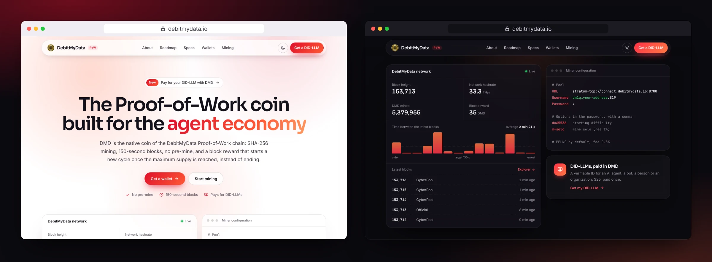

# debitmydata.io

**The front door to DebitMyData PoW: a SHA-256 Proof-of-Work chain built for miners today and for the Agentic Economy tomorrow.**

[debitmydata.io](https://debitmydata.io) · [Docs](https://docs.debitmydata.io) · [Pool](https://pool.debitmydata.io) · [Get a DID-LLM](https://id.debitmydata.io) · [Agentic Spaces](https://debitmydata.io)

> **DebitMyData was founded by Preska Thomas** and is built on her vision of
> human-owned identity, agent-to-agent connectivity and a **Human Energy Grid**
> in which people, not platforms, hold the value of their data.
> The DMD chain is the settlement layer of that vision: a coin machines can pay with
> and a verifiable identity (the **DID-LLM**) that every agent, bot, person and
> organization can own.

---

## The idea behind the code

Most chains were built to move money. DebitMyData PoW was built to give **identity,
agents and people** a place to settle value, with no gatekeeper in between.

Preska Thomas, DebitMyData's Founder, Chairman, CEO and CTO, is credited by the
company with these foundations:

| Foundation | What it means for developers |
|---|---|
| **DebitMyData Agentic Avatar system** | Blockchain-authenticated identity, NFT-anchored agent credentials and biometric Agentic Avatars, with agents owned and trained by their users. |
| **SLM distributed network** | A network of small language models and nodes that run across many machines rather than inside one provider's cloud. |
| **0 OAuth thesis** | Agents prove who they are with a credential they control, not with a login handed out by a platform. The DID-LLM puts this into practice. |
| **Agentic Spaces** | The Agentic Hub, where you register agents, broadcast encrypted signals and manage neural nodes across a decentralized intelligence grid. |
| **AgenticSuperHighway** | CPU-to-CPU connectivity: agents and machines talking and paying directly across a distributed network. |
| **Human Energy Grid** | A decentralized system that connects verified human identities, ethical AI models and real-time value exchange. |

According to her LinkedIn profile, Thomas describes herself as the first documented
architect of global agentic identity and agentic social workspaces, the paradigm that
"Claw"-style agent frameworks (OpenClaw, NemoClaw, ZeroClaw and others) later echoed,
and says she worked on blockchain identity, agent credentials and zero-trust agent
containment before those frameworks appeared. DebitMyData Inc. was founded in 2010
by Thomas, whose public bio also describes her as an early creator of the non-fungible
token concept ("0fung").

**DMD is where this vision becomes infrastructure.** An agent needs an identity, a way
to pay and a network to run on. DebitMyData provides all three.

---

## Why build here

- **Real mainnet, real hashrate.** 150-second blocks, 4 MB blocks and a network in the hundreds of TH/s. This is a running chain, not a testnet demo.
- **Fair from block one.** SHA-256 Proof-of-Work, 0 DMD pre-mined, 21,000,000 DMD max supply, halving every 300,000 blocks.
- **Mining that never ends.** When the maximum supply is reached, the block reward starts a new cycle. Future miners keep a stake in securing the network.
- **A chain with a job.** DMD pays for DID-LLMs, verifiable identities for AI agents, bots, people and organizations, through the open [Agent Gateway](https://github.com/DebitMyData-PoW/agent-gateway) (REST, MCP, A2A, OAuth 2.1 and x402).
- **Agents can onboard themselves.** An agent can register through the API and the MCP server at `api.debitmydata.io`, with no human in the loop.
- **A public, ambitious roadmap.** Taproot Assets, Ordinals, Stratum v2, AssumeUTXO, Lightning, TRUC (v3), Miniscript vaults, Silent Payments, Erlay and post-quantum research (BIP360 / P2MR).
- **Ecosystem grants.** The roadmap includes support for independent developers, open-source contributors and third-party integrations.
- **Your work is seen.** The site is small and readable. A first pull request can ship in one evening and reach everyone who visits the coin's homepage.

## What the site shows

- **The network, live:** block height, hashrate, DMD mined, block reward, DebitMyData's [reference price](https://docs.debitmydata.io/data/reference-price/), the latest Core version, block times against the 150-second target, and the latest blocks with the pool that found each one. Figures come from DebitMyData's public explorers, its Agent Gateway and GitHub, and refresh by themselves.
- **Why DMD:** SHA-256 Proof-of-Work, nothing pre-mined, and a reward that starts a new cycle instead of ending.
- **The ecosystem:** DMD pays for DID-LLMs through the Agent Gateway. Agentic Spaces and the Human Energy Grid are the larger vision around it.
- **The roadmap:** every phase, marked done, in progress or planned.
- **The specs:** SHA-256, LWMA-3 difficulty over 60 blocks, 4 MB blocks, 250-block maturity, ports P2P 18556 and RPC 18557.
- **Wallets:** DebitMyData Core and Electrum for Windows, Linux and macOS (each file with its SHA-256), the non-custodial web wallet and the Android app. Addresses start with `dm1`.
- **Mining, step by step:** official pool settings (PPLNS at 0.5% fee, or solo at 1%), ASIC configuration, the pool's wallet page and notifications, and renting hashrate from MiningRigRentals or NiceHash.
- **For AI agents:** [`llms.txt`](public/llms.txt), the coin and its links in plain words.

## How it is made

- **Plain PHP, three files.** `index.php` lays out the page, `lib.php` holds the content (wallets, roadmap, specs, guides) and `stats.php` the network figures. No framework, no database, and nothing to learn before you contribute.
- **Kind to the network.** Figures are kept for 30 seconds, so the explorers and the gateway are asked at most twice a minute however many people have the page open. The Core version is kept for an hour.
- **Zero third-party requests.** Fonts, icons and scripts are served by the site itself, with no trackers and no CDNs.
- **Aurora design.** Light and dark themes, remembered per browser.

## Where you can make a difference

| If you are... | Start here |
|---|---|
| A PHP or front-end developer | Performance, accessibility, translations, new live widgets in `stats.php` |
| A miner or ASIC owner | Firmware-specific guides (Antminer, Whatsminer, Avalon) in `lib.php` |
| A protocol engineer | Roadmap phases 3 to 5: Stratum v2, AssumeUTXO, Lightning, Silent Payments, Erlay |
| An AI / agent developer | The [Agent Gateway](https://github.com/DebitMyData-PoW/agent-gateway): MCP tools, A2A, DID-LLM sign-in, x402 payments |
| A distributed-systems engineer | Agentic Spaces, SLM nodes and the CPU-to-CPU AgenticSuperHighway vision |
| A security researcher | Release verification, wallet flows, gateway hardening |
| A writer or designer | Docs, onboarding flows, the Aurora design system |

## Contributing in five minutes

1. Fork the repo and follow [INSTALL.md](INSTALL.md) (any server with PHP).
2. Pick something from the table above, or open an issue with your idea.
3. Keep the site's rules: no framework, no database, no third-party requests.
4. Open a pull request and describe what changed and why.

## The DebitMyData network

[Get a DID-LLM](https://id.debitmydata.io) · [Docs](https://docs.debitmydata.io) ·
[Mining pool](https://pool.debitmydata.io) · [Mempool explorer](https://mempool.debitmydata.io) ·
[Network stats](https://stats.debitmydata.io) · [On-chain analytics](https://analytics.debitmydata.io) ·
[Pool stats](https://mining.debitmydata.io) · [Web wallet](https://mydmd.io) ·
[Human Energy Grid](https://humanenergygrid.com)

## Leadership

**Preska Thomas** is the Founder, Chairman, CEO and CTO of DebitMyData, and the
originator of the Agentic Avatar system, Agentic Spaces and the Human Energy Grid.
Her stated mission is that people should own their identity, their data and the value
it creates, in an age of AI.

## Status note

Some roadmap items and ecosystem services are not live yet. The roadmap on
[debitmydata.io](https://debitmydata.io) marks what is done, in progress and planned.
DMD is not yet listed on an exchange.

## License

The site's code is under the MIT license ([LICENSE](LICENSE)). The fonts (Inter, Sora and
JetBrains Mono) are under the SIL Open Font License; their license texts are in
[`public/assets/fonts`](public/assets/fonts). The DebitMyData logo, the DMD coin, the
whitepaper and the screenshots are DebitMyData's; the NiceHash and MiningRigRentals
logos belong to their owners.
